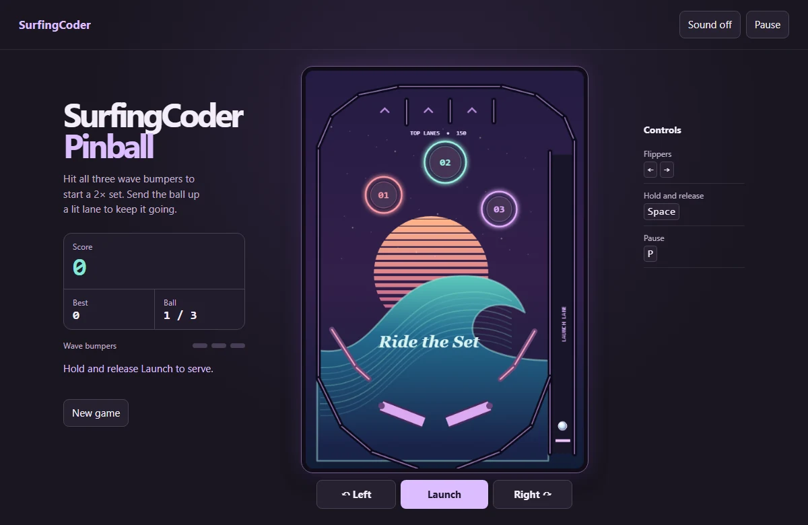

# SurfingCoder Pinball

A browser pinball game with a sunset surf table, three balls per game, optional synthesized sound, and a personal best saved in the browser.

Play at [SurfingCoder](https://surfingcoder.com/pinball/).

## Play

Hold and release **Space** or **Launch** to serve the ball. Use the **Left/Right arrows**, **A/D**, or the two touch buttons to move the flippers. Press **P** or use the pause button to pause. Choose **Sound off** to enable sound.

Each wave bumper scores 100 points, each slingshot scores 25, and each top lane scores 150. Hit all three wave bumpers in one ball to earn 300 bonus points and start a ten-second 2× set. Top lanes extend the set by three seconds, up to twelve seconds remaining.

## Run locally

Serve this directory with any static server. With Python 3, run `python -m http.server 8000 --bind 127.0.0.1`, then open [localhost:8000](http://127.0.0.1:8000/).

The game uses Canvas, Web Audio, and browser storage. All artwork and sound are generated in the browser. The physics use a fixed time step and account for the motion of the flippers during collisions.

Run `node --test physics.test.mjs` to verify the table rules with Node.js.
